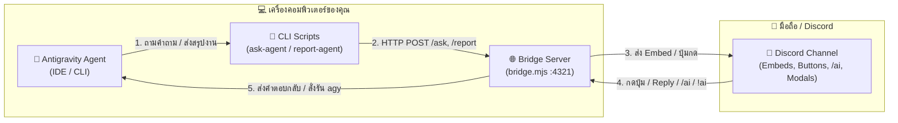

# 🚀 Antigravity Discord Bridge

**Antigravity Discord Bridge** คือระบบเชื่อมต่อแบบสองทาง (Two-Way Interactive Bridge) ระหว่าง **Antigravity AI Agent (IDE & CLI)** กับ **Discord** ช่วยให้คุณสามารถติดตามสถานะ ตอบคำถามตัดสินใจ และสั่งงาน AI Agent ต่อเนื่องได้จากทุกที่ผ่านโทรศัพท์มือถือหรือแอปพลิเคชัน Discord โดยไม่ต้องนั่งเฝ้าหน้าจอคอมพิวเตอร์

---

## 🎯 โปรเจกต์นี้เอาไว้ทำอะไร?

เวลาสั่งงาน AI Agent ขนาดใหญ่ในโปรเจกต์ (เช่น Refactor โค้ด, สร้างฟีเจอร์ใหม่, รันเทสต์) มักเกิดปัญหาหลัก 2 ข้อ:
1. **AI ติดคำถามระหว่างทาง (Blocking Questions)**: AI ต้องการถามเพื่อความแน่ใจ (Clarification / Decision) หากคุณไม่ได้อยู่หน้าจอ งานจะหยุดชะงักทันที
2. **ไม่รู้ว่างานเสร็จหรือพังเมื่อไหร่**: ต้องคอยเดินกลับมาเช็กหน้าจอคอมพิวเตอร์เป็นระยะ และหากต้องการสั่งงานต่อก็ต้องกลับมาพิมพ์ที่เครื่อง

**Antigravity Discord Bridge** เข้ามาแก้ปัญหานี้โดยทำหน้าที่เป็น **ตัวกลาง (Local HTTP + Discord Bot)** ที่ดักจับคำถามจาก AI ส่งเข้าแชท Discord พร้อมปุ่มกดเลือกตอบได้ทันที และส่งสรุปผลงานเมื่อทำเสร็จ พร้อมรองรับการ **กด Reply ข้อความใน Discord เพื่อสั่งงาน AI ต่อได้ทันที**

---

## ✨ ประโยชน์และจุดเด่นหลัก (Key Benefits)

- 📱 **Work From Anywhere (ควบคุมผ่านมือถือ 100%)**
  ไม่ต้องนั่งเฝ้าหน้าจออีกต่อไป ลุกไปทำธุระแล้วรอรับแจ้งเตือนและกดอนุมัติงานผ่านสมาร์ตโฟนได้ทันที
- 🔘 **Interactive Decision Buttons & Smart Clarification (Auto Grill-me)**
  เมื่อคำสั่งกำกวมหรือ AI มีตัวเลือกให้ตัดสินใจ ระบบจะสร้างปุ่มกด (Buttons) บน Discord ให้คลิกเลือกได้ในสัมผัสเดียว หรือพิมพ์ Reply ตอบกลับแบบข้อความอิสระก็ได้ก่อนลงมือทำจริง
- ⏱️ **Live Progress Updates (ทุกๆ 10 วินาที) & One-Click Stop**
  อัปเดตการ์ดสถานะการทำงานบน Discord อัตโนมัติทุกๆ 10 วินาที แสดงเวลาที่ผ่านไปและขั้นตอน/Tool ล่าสุดที่ AI กำลังเรียกใช้งานแบบสดๆ พร้อมปุ่ม `🛑 Stop` บนการ์ดเพื่อกดหยุดได้ทันที
- ↩️ **Git Snapshot & One-Click Keep / Revert**
  สำรองสถานะโค้ดก่อนเริ่มงานอัตโนมัติ เมื่อทำงานเสร็จจะสรุปสถิติไฟล์ที่แก้ไข (`git diff --stat`) แนบไฟล์ `output.md` หากผลลัพธ์ยาว และมีปุ่ม `✅ Keep all` หรือ `↩️ Revert all` ให้กดย้อนคืนโค้ดกลับสู่สถานะเดิมได้ในคลิกเดียว
- 📊 **Real-time Task Reporting**
  รายงานทุกสถานะ (`started`, `progress`, `completed`, `failed`) ด้วย Discord Embed แยกสีชัดเจน พร้อมสรุปรายชื่อไฟล์ที่แก้ไขและ Code Snippet
- 🔄 **Two-Way Remote Execution (Slash Commands `/ai`, `/review`, Dropdown & Reply-to-Continue)**
  สั่งงานได้หลายวิธี: พิมพ์ `/ai` หรือ `/review` พร้อมระบบ **Auto-complete ชื่อโปรเจกต์**, เลือกจาก **Dropdown Menu (`/projects`)** พร้อมฟอร์มป๊อปอัป (Modal), พิมพ์ `!ai` / `!review` หรือกด **Reply** ที่ข้อความสรุปงานของบอทเพื่อสั่งรัน `agy` ต่อในโฟลเดอร์โปรเจกต์นั้นๆ ได้ทันที
- 📂 **Auto-Scan Multi-Project Registry & Auto-Queue Runner**
  สแกนหาโฟลเดอร์โปรเจกต์ทั้งหมดในเครื่องอัตโนมัติผ่าน `PROJECTS_DIR` ใน `.env` จดจำ Path ลง `projects.json` และมีระบบคิวงาน (`!prompt`) ที่ดึงคำสั่งถัดไปมารันต่อให้อัตโนมัติเมื่อจบงานก่อนหน้า
- 🛡️ **Automatic Fallback Guard**
  หากปิดบอทหรือไม่ได้เชื่อมต่ออินเทอร์เน็ต AI จะสลับกลับมาถามผ่านหน้าต่าง Antigravity IDE ปกติโดยอัตโนมัติ งานไม่สะดุด

---

## 🔄 แผงผังการทำงาน (Architecture Flow)



---

## 📚 สารบัญคู่มือการติดตั้งและใช้งาน (Documentation)

เพื่อให้การอ่านและการตั้งค่าไม่ยาวหรือลายตาเกินไป คู่มือถูกแบ่งออกเป็นไฟล์ย่อยตามลำดับขั้นตอนดังนี้:

1. 🤖 **[01 - การสร้างและตั้งค่า Discord Bot](docs/01-discord-bot-setup.md)**
   วิธีสร้างบอทใน Discord Developer Portal, เปิดสิทธิ์ Message Content Intent, เชิญบอทพร้อมสิทธิ์ Slash Commands และดึง `TOKEN` กับ `CHANNEL_ID`
2. 🍎 **[02 - คู่มือการติดตั้งสำหรับ macOS](docs/02-install-macos.md)**
   ขั้นตอนติดตั้งแบบละเอียดสำหรับผู้ใช้ Mac, การตั้งค่า `.env` (`PROJECTS_DIR`), การผูก CLI เข้า `PATH` และการรันเป็น Background Service
3. 🪟 **[03 - คู่มือการติดตั้งสำหรับ Windows](docs/03-install-windows.md)**
   ขั้นตอนติดตั้งแบบละเอียดสำหรับผู้ใช้ Windows, การสร้างไฟล์ `.cmd` Wrapper สำหรับเรียกใช้งานผ่าน PowerShell/CMD และการตั้งค่า Path
4. ⚙️ **[04 - การตั้งค่า Rules ให้ Antigravity ทำงานอัตโนมัติ](docs/04-antigravity-rules.md)**
   การตั้งค่าไฟล์ Rule (`discord-bridge.md` และ `workflow.md`) เพื่อบังคับให้ AI ส่งคำถามและรายงานผลเข้า Discord เสมอ
5. 📖 **[05 - คู่มือคำสั่งและการใช้งาน (Usage & Commands)](docs/05-usage-and-commands.md)**
   รวมคำสั่งควบคุมผ่านแชท Discord ทั้ง Slash Commands (`/ai`, `/review`, `/projects`, `/status`, `/stop`, `/help`), Interactive Dropdown & Modal, Text Commands (`!ai`, `!review`, `!status`, `!projects`, `!stop`), วิธีใช้งาน CLI (`ask-agent`, `report-agent`, `review-agent`) และการใช้ Skill ใน Antigravity IDE

---

## ⚡ Quick Start (สำหรับผู้ที่ตั้งค่าครบแล้ว)

```bash
# 1. ติดตั้ง Dependencies
npm install

# 2. คัดลอกไฟล์ .env.example เป็น .env แล้วใส่ค่า Token และ Channel ID
cp .env.example .env

# 3. รันระบบ Bridge Server
node bridge.mjs

# 4. ทดสอบส่งคำถามเข้า Discord จาก Terminal
ask-agent "ต้องการใช้ฐานข้อมูลตัวไหน?" "buttons" "pg:PostgreSQL:Primary,sqlite:SQLite:Secondary"

# 5. ทดสอบส่งรายงานสรุปงานเข้า Discord
report-agent completed "สร้างระบบ Authentication เสร็จเรียบร้อย" "src/auth.ts"
```

---

## 📁 โครงสร้างไฟล์ในโปรเจกต์

```text
antigravity-discord-bridge/
├── bridge.mjs          # เซิร์ฟเวอร์หลัก (Express API + Discord.js Bot + Slash Commands + agy Spawner)
├── projects.json       # ฐานข้อมูลเก็บรายชื่อโปรเจกต์คู่กับโฟลเดอร์ (สร้าง/สแกนอัตโนมัติ ไม่ถูกอัปโหลดขึ้น Git)
├── package.json        # ข้อมูลโปรเจกต์และรายการ Dependencies
├── .env.example        # ไฟล์ตัวอย่างสำหรับการตั้งค่า Environment Variables
├── .env                # ไฟล์เก็บค่าจริงของ DISCORD_BOT_TOKEN, DISCORD_CHANNEL_ID และ PROJECTS_DIR (Ignored)
├── .gitignore          # ไฟล์กำหนดรายการที่ไม่นำขึ้น GitHub (เช่น .env, node_modules, projects.json)
├── bin/
│   ├── ask-agent       # CLI Script สำหรับให้ AI ส่งคำถามและรอคำตอบจาก Discord
│   ├── report-agent    # CLI Script สำหรับให้ AI ส่งรายงานสถานะ/ผลลัพธ์เข้า Discord
│   └── review-agent    # CLI Script สำหรับสั่งรีวิวโค้ดและ Feature
├── .agents/
│   └── skills/
│       └── review/     # Skill สำหรับการตรวจสอบโค้ดและ Feature ใน Antigravity
└── docs/               # คู่มือการติดตั้งและการใช้งานแยกตามหัวข้อ
```
